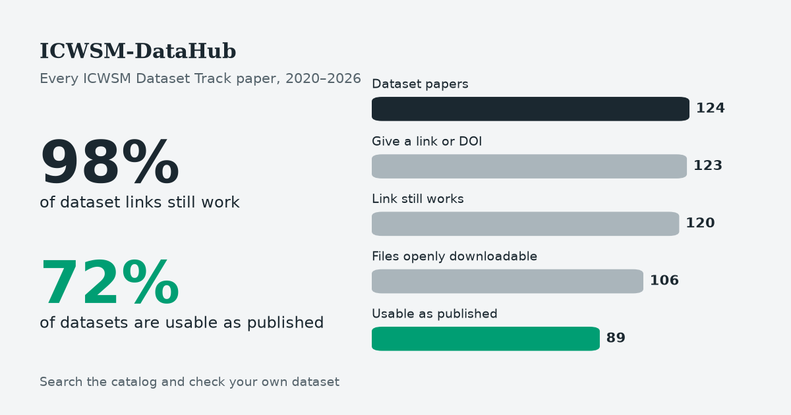
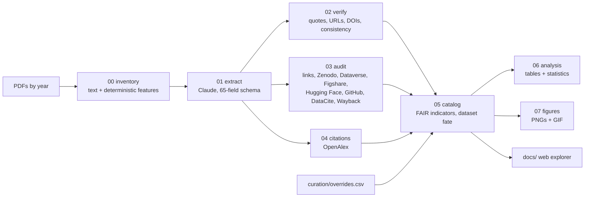

# ICWSM-DataHub

**Every dataset paper in the ICWSM Dataset Track, 2020–2026: what each one shared, and whether you can still use the data today.**

**[Explore the catalog →](https://meclin2345.github.io/icwsm-datahub/)**



ICWSM publishes dozens of papers each year whose main contribution is a dataset. This project puts all 124 of them (2020–2026) in one searchable catalog and checks each one live.

## What we found

- **Links last; access is the problem.** 98% of the dataset links and DOIs given in these papers still work. But only 72% of the datasets can be used exactly as published. Most of the rest are either restricted on purpose, behind a request form or agreement, or are Twitter/X post IDs that now need a paid API to rebuild.
- **The 2023 API closures moved the field.** Twitter/X appears in 40% of datasets collected before March 2023, against 12% of those collected after.
- **LLM labels arrived fast.** No dataset used LLM-made labels before 2024. By 2026, 26% did.
- **The 2024 paper checklist changed what papers say more than how data is shared.** Discussion of misuse risks went from 30% to 88% of papers. Dataset DOIs (81% vs 78%) and licenses on repository pages (86% vs 84%) were already high and stayed there.

The [web explorer](https://meclin2345.github.io/icwsm-datahub/) tells the full story, live from the data.

## What you get

| Output | Where | For |
|---|---|---|
| Catalog (CSV, Parquet, JSON) | `catalog/` and `docs/data/` | Finding datasets, meta-research |
| Data dictionary and Croissant metadata | `catalog/DATA_DICTIONARY.md`, `catalog/croissant.json` | Every column documented; machine-readable metadata |
| Web explorer | `docs/` (GitHub Pages) | Search, filters and the animated story |
| Statistics and tables | `results/` | Trend tests, link survival, before-and-after checklist |
| Figures | `figures/` | Static figures and the animated chart |
| Link-check history | `data/audit/` | Re-checked monthly by GitHub Actions |

## How much to trust it

Each paper was read by an AI model (Claude) against a 65-field codebook. Each key field is backed by a verbatim quote from the paper. Automatic checks then compared the output with the paper text:

- 89–96% of evidence quotes were found word for word or nearly so
- 97% of dataset URLs were found in the paper
- 97% of DOIs were found in the paper

Records that the consistency checks flagged were reviewed by hand. Every dataset link was then tested live, and the "can you use it" status comes from that test, not from the model.

Some entries will still be wrong. **If you spot an error, especially in your own paper, please [open an issue](https://github.com/meclin2345/icwsm-datahub/issues/new?labels=correction&title=Correction).** Fixes are logged in `data/curation/overrides.csv` with a reason, so every change is traceable.

## Rebuild it yourself

```bash
pip install -r requirements.txt

# See the whole stack working on synthetic data (no API key needed)
make demo
python -m http.server -d docs 8000      # open http://localhost:8000
```

Demo data is invented. The explorer shows a banner and `key_numbers.tex` carries a warning while it is in use.

### Run it on the real papers

Extraction goes through an Anthropic-compatible gateway. The default is Opus Code (`https://claude.opuscode.pro/api`) with model `claude-fable-5-1`. Put the PDFs in `data/papers/<year>/` (loose PDFs or one folder per paper both work), then:

```bash
export LLM_API_KEY=...                           # your Opus Code key
export AUDIT_CONTACT_EMAIL=you@university.edu     # identifies the audit politely to repositories

make check-api        # once: lists models, shows your key's 5-hour token window, tests structured output
make inventory        # PDF -> text, deterministic features
make extract-dry      # token counts and how many 5-hour windows the full run needs
make extract-pilot    # 20 papers: read these records against the PDFs by hand
make extract-all      # the rest; waits automatically when the token window is spent, resumable
make verify audit cite catalog analysis figures   # catalog also redraws docs/social-card.png
```

**Gateway notes.**
- If the gateway rejects or ignores `output_config` structured outputs, `01_extract.py` switches automatically to schema-in-prompt mode. The JSON is validated with Pydantic and repaired once if needed. `check_api.py` tells you which mode applies.
- Opus Code documents no Message Batches API, so use sync mode. Batch mode remains available for Anthropic's own API (`LLM_BASE_URL=https://api.anthropic.com`).
- Each record logs the requested model, the model the gateway reports serving, the API host and the structured-output mode. `data/interim/api_capabilities.json` records the probe results. 

Optional tokens raise rate limits: `ZENODO_TOKEN`, `DATAVERSE_TOKEN`, `GITHUB_TOKEN`, `HF_TOKEN`.

## How it works



**Extraction.** `icwsm_datahub/schema.py` defines 65 attributes, sent to Claude Fable 5.1 through the gateway configured in `icwsm_datahub/llm_client.py`. Everything that gets plotted is a controlled vocabulary, so “Twitter”, “X” and “Twitter API v2” never need reconciling by hand. Every field is required, and unknown values use sentinels (`""`, `-1`, `[]`). This keeps the schema inside Claude’s structured-output limits (at most 24 optional and 16 union-typed fields). Facts that code can compute, such as year, page count, checklist presence and URLs in the text, are never asked of the model.

**Verification.** `02_verify.py` checks that every evidence quote, dataset URL and DOI really occurs in the paper text, and flags fields that contradict each other. It can also draw a year-stratified sample for blind human coding and score agreement per field (`--make-sample`, `--score`).

**Audit.** `03_audit.py` treats “HTTP 200” as the start of the investigation, not the end. It detects soft-404 pages, parked domains and login walls; reads file lists, sizes, restrictions and download counters from repository APIs; and checks the Wayback Machine for dead links.

**Two derived constructs carry the analysis** (`icwsm_datahub/fair.py`):

- **Ten operational FAIR indicators** (F1, F2, F4, A1, A1.1, A2, I1, R1.1, R1.2, R1.3), combining what papers report with what the audit observes. They are binary so anyone can recompute a score by hand.
- **Dataset fate in 2026.** Every dataset falls in exactly one state: *open and usable*, *IDs only, needs the X API*, *restricted access*, *alive but empty or sign-in only*, *link not reachable*, or *no link in the paper*.

## Methodological choices worth knowing

- **Measure API shocks on data time.** Papers lag their data by one to two cycles. `coverage_end_year` shows the 2023 break sharply, while publication year blurs it.
- **Compare downloads only within one repository.** Zenodo, Dataverse, Figshare and Hugging Face count downloads differently. Figure 7 uses Zenodo alone.
- **“Multimodal” means more than one content modality** (text, image, video, audio). Metadata and networks accompany almost every dataset.
- **Global North and South** use a documented Brandt-line-style approximation (`normalize.py`).

## Corrections

Errors are fixed in `data/curation/overrides.csv`, never by editing extracted JSON:

```csv
paper_id,field,value,reason,curator
2021_example_ab12cd,distribution.persistent_doi,10.5281/zenodo.1234567,DOI in footnote 3,NS
```

Overrides are applied at build time and counted per record (`n_manual_overrides`), so every human correction is traceable.

## Reproducibility

Each record stores the model, prompt version, schema version, timestamp and token usage. Each audit check stores its UTC time. The extraction prompt (`icwsm_datahub/prompts.py`) and schema are versioned; bump the version when you change either.

## What is not in this repository

The papers themselves and their full text. `data/papers/` and `data/interim/text/` are git-ignored. The catalog links to each paper’s DOI and keeps only short evidence quotes.

## Cite

See `CITATION.cff`, or use GitHub's "Cite this repository" button. Each release is archived on Zenodo with a DOI.

## License

Code: MIT. Catalog data: CC BY 4.0. Papers remain under their publishers’ terms.
